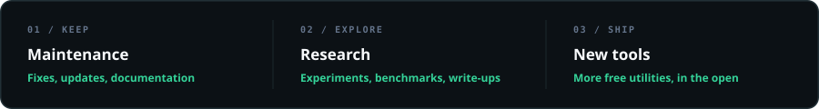

<div align="center">
  
  <br><br>
  
</div>

---

### 💵 Stablecoins (Recommended)

<sub>Lowest fees: USDT on Tron or TON. Use the copy button on the right of each address.</sub>

 &nbsp;**USDT · TRX** — Tron network

```text
TCe57bLA4KBqcPc3ApKauE4VHLd3WqW1WT
```

 &nbsp;**USDT · TON** — TON network

```text
UQAEvC5puI21Z5OtPTo6SilVWtElgyZXvH8VIHLLKGxRL4AO
```

 &nbsp;**USDT · USDC · ETH** — Ethereum, Arbitrum, Base, Optimism, Polygon, BSC

```text
0xdcE037bdF1c580A98D58815C508F7B4d7f7c4603
```

### 🪙 Native Coins

 &nbsp;**BTC** — Bitcoin Native SegWit

```text
bc1q6nvqcw53r36w9gsjw429d6v3reshjr0pn8frrm
```

<sub>TRX, TON and ETH go to the same Tron, TON and EVM addresses above.</sub>

> [!IMPORTANT]
> **Match the network to the address before sending** — transfers on the wrong network can't be recovered.<br>
> `T…` Tron TRC-20 &nbsp;·&nbsp; `UQ…` TON &nbsp;·&nbsp; `0x…` EVM networks &nbsp;·&nbsp; `bc1…` Bitcoin Native SegWit

<details>
<summary><b>📱 Show QR Codes for Mobile Wallets</b></summary>

<br>

<table align="center">
  <tr>
    <td align="center"></td>
    <td align="center"></td>
    <td align="center"></td>
    <td align="center"></td>
  </tr>
  <tr>
    <td align="center"><b>USDT · TRX</b><br><sub>Tron · TRC-20</sub></td>
    <td align="center"><b>USDT · TON</b><br><sub>TON network</sub></td>
    <td align="center"><b>BTC</b><br><sub>Native SegWit</sub></td>
    <td align="center"><b>USDT · USDC · ETH</b><br><sub>EVM networks</sub></td>
  </tr>
</table>

</details>

---

<div align="center">
  <sub><b>Thank you</b> — every tip, of any size, genuinely matters.</sub><br>
  <sub>Not in a position to donate? A ⭐ on a repo or sharing a project helps just as much.</sub>
</div>
